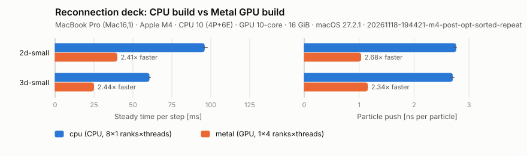
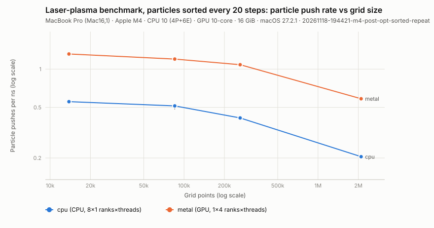
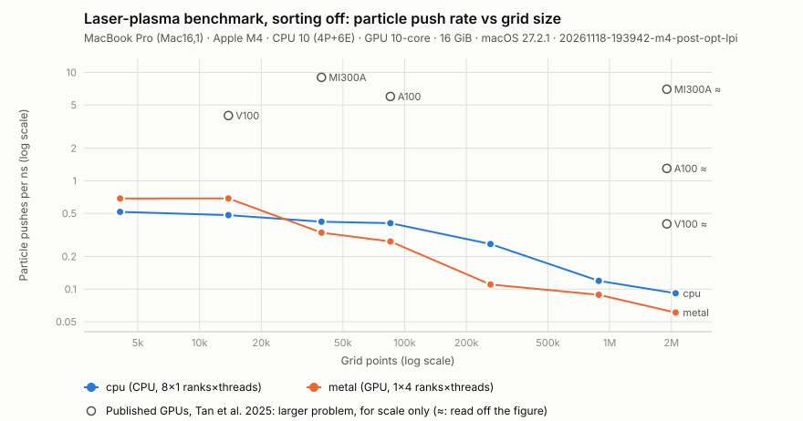

# VPIC on Apple GPUs: benchmark report

This report compares two builds of VPIC-Kokkos on the same laptop and the same physics:

- **CPU build**: the original code path, Kokkos with OpenMP plus MPI, run as 8 MPI ranks with 1 thread each. That
  is the fastest CPU layout measured on this machine.
- **Metal build**: this fork with `VPIC_ENABLE_METAL=ON`, run as 1 MPI rank with 4 threads. The particle push, the
  particle sort, the charge deposit for divergence cleaning and the particle energy sum run on the GPU as Metal
  kernels. Everything else, including the field solve, runs on the CPU threads.

Both builds come from commit `9146807` on branch `fix/apple-gpu-portability`.

## Machine

| Item | Value |
| --- | --- |
| Computer | MacBook Pro (Mac16,1), on mains power |
| Chip | Apple M4: 10 CPU cores (4 performance, 6 efficiency), 10-core GPU |
| Memory | 16 GB, shared by CPU and GPU (about 97 GB/s for either) |
| Software | macOS 27.2.1, Open MPI 5.0.11, Kokkos 5.2.2 |

These are results for a base M4. The Pro and Max chips have more GPU cores and more memory bandwidth, so the GPU
share of the work should scale better on them. That has not been measured yet.

## The benchmarks

All runs use the benchmark harness in this directory (see [../README.md](../README.md) for how it works). Each
case runs once to warm up and then 3 measured times per build, and the report uses the median.

### Magnetic reconnection (Harris current sheet)

The classic VPIC reconnection problem, after Daughton, Phys. Plasmas 9, 3668 (2002), adapted from Kevin Bowers'
Harris deck ([decks/harris_bench.deck](../decks/harris_bench.deck)).

| Case | Grid | Macro particles | Notes |
| --- | --- | ---: | --- |
| 2D | 512 × 512 × 1 | 26.2 M | 100 per cell, electrons and ions |
| 3D | 64 × 64 × 64 | 16.8 M | 64 per cell |

Particles are sorted by cell every 20 steps. Each run is 40 steps, and the timing covers the last 20. Divergence
cleaning runs every 20 steps and the energies are written every 10, both far more often than in production runs.

### Laser-plasma interaction (LPI)

VPIC's own published benchmark deck, `sample/benchmark.cxx` by Scott Luedtke, adapted as
[decks/lpi_bench.deck](../decks/lpi_bench.deck). It models a laser speckle in an electron and ion plasma. Bird
et al. (IEEE TPDS 2021) and Tan, Luedtke, Taufer and Albright (SC Workshops 2025, doi:10.1145/3731599.3767493)
report results from versions of it.

Every LPI case has 12 million macro particles. The grid ranges from 16³ to 128³ cells in the same box, so the
particles per cell fall from about 2,900 to about 6. Two sets were run:

- **Sorted**: particles sorted by cell every 20 steps, the way VPIC normally runs.
- **Unsorted**: sorting switched off, the method of Tan et al., Fig. 9, which measures the push alone. These are
  the only cases with published GPU numbers to compare against.

Runs are 40 steps with the timing over the last 20. Divergence cleaning in this deck runs every 100 steps, so it
never falls inside the timed window.

### What is measured

| Metric | Meaning |
| --- | --- |
| Time per step | Wall-clock time of the last 20 steps divided by 20, summed over all of VPIC's timed phases except the energy dumps. Lower is better. |
| Push rate | Macro particles × steps ÷ time spent in the particle push, in particle pushes per nanosecond. Higher is better. This is the metric of Bird et al. and Tan et al. |
| Speed-up | CPU time per step ÷ Metal time per step. Above 1 means the GPU build is faster. |

### Physics check

Neither build is bitwise repeatable: GPU atomics and multithreaded CPU sums add in a different order each run.
Instead, every run's energy history is compared with the CPU build's first measured run. The bulk columns must
agree within 1e-3: the particle kinetic energies, plus one magnetic field energy for reconnection. The other field
energies must agree within 1e-2.

Every run in this report passed. The largest difference in any energy column was 7.6e-6.

## Results

### Reconnection: the GPU build is about 2.4 times faster



| Case | CPU ms/step | Metal ms/step | Speed-up | CPU pushes/ns | Metal pushes/ns |
| --- | ---: | ---: | ---: | ---: | ---: |
| 2D | 95.9 | 39.8 | 2.41× | 0.36 | 0.97 |
| 3D | 60.4 | 24.8 | 2.44× | 0.37 | 0.87 |

The speed-up for each step is lower than for the push alone, because the field solve and the particle boundary
exchange still run on the CPU in the Metal build. Leaving out the divergence-cleaning phases, which production
runs do far less often, gives 2.43× for both 2D and 3D.

### Laser-plasma, sorted: 2.1 to 2.5 times faster



| Grid | Particles per cell | CPU ms/step | Metal ms/step | Speed-up | CPU pushes/ns | Metal pushes/ns |
| --- | ---: | ---: | ---: | ---: | ---: | ---: |
| 24³ | 868 | 28.1 | 11.3 | 2.49× | 0.55 | 1.32 |
| 44³ | 141 | 31.3 | 12.6 | 2.49× | 0.51 | 1.20 |
| 64³ | 46 | 38.3 | 15.4 | 2.49× | 0.41 | 1.08 |
| 128³ | 6 | 90.0 | 42.7 | 2.11× | 0.20 | 0.58 |

The push rate of both builds falls as the grid grows. The 12 million particles and their fields stop fitting in the
caches, and at 128³ the field step itself becomes a larger share of the time.

### Laser-plasma, unsorted: the GPU build wins only on small grids



| Grid | CPU ms/step | Metal ms/step | Speed-up | CPU pushes/ns | Metal pushes/ns |
| --- | ---: | ---: | ---: | ---: | ---: |
| 16³ | 30.1 | 18.3 | 1.64× | 0.52 | 0.69 |
| 24³ | 33.5 | 18.4 | 1.82× | 0.48 | 0.69 |
| 34³ | 35.5 | 37.2 | 0.95× | 0.42 | 0.33 |
| 44³ | 38.4 | 45.1 | 0.85× | 0.41 | 0.28 |
| 64³ | 57.3 | 112.7 | 0.51× | 0.26 | 0.11 |
| 96³ | 118.5 | 148.1 | 0.80× | 0.12 | 0.09 |
| 128³ | 160.8 | 225.2 | 0.71× | 0.09 | 0.06 |

Without sorting, neighbouring GPU threads push particles that sit in unrelated cells. The GPU then reads fields
from scattered addresses, and its per-cell current reduction rarely finds threads that share a cell, so most
current goes out as scattered atomic adds. From 34³ up the CPU build is faster. VPIC production runs sort
particles, so the sorted results above are the ones that matter in practice. The unsorted set is kept because it
is the published method.

The open circles are published results from Tan et al. (2025) for NVIDIA V100 and A100 and AMD MI300A GPUs. Those
runs used a larger problem on data-centre GPUs, so they show the scale of a large GPU, not a like-for-like
comparison. Points marked ≈ were read off the paper's figure by eye.

## How the GPU build improved

The previous runs on the same cases, made after the particle sort had moved to the GPU but before the push,
field and particle-loop optimisations, gave these speed-ups:

| Case | Earlier speed-up | Now |
| --- | ---: | ---: |
| Reconnection 2D | 1.84× | 2.41× |
| Reconnection 3D | 2.26× | 2.44× |
| LPI sorted 24³ | 2.40× | 2.49× |
| LPI sorted 128³ | 1.91× | 2.11× |

Almost all of the gain came from the Metal build. Its time per step fell by 7 to 24%. The CPU build's times
stayed within run-to-run noise, although two of the changes also apply to it. The CPU's 2D field step dropped from
4.6 to 2.8 ms, but the 2D CPU total did not change visibly.

## Caveats

- **One machine.** All numbers are from a base M4 with 16 GB. Problem sizes were kept small enough for that.
- **Short runs.** Each run is 40 steps. Divergence cleaning and energy output run much more often than in real
  simulations. For the reconnection cases, leaving the cleaning out changes the speed-up by less than 0.03×.
- **Repeatability.** The sorted set was run twice, once right after other work and once after waiting for a quiet
  machine. The Metal times agreed within 4% and the speed-ups within 0.15×. The tables use the quiet run. Four of
  its runs started while a macOS indexing process was busy. Their medians match the first session.
- **Field solve on the CPU.** In the Metal build the field solve still runs on 4 CPU threads. Moving it to the GPU
  is the next planned step, and matters most for large grids and the Pro and Max chips.

## Raw data and reproducing

Every run's logs, energies, configuration and summary are in [../results/](../results/):

| Results folder | Contents |
| --- | --- |
| `20261118-194421-m4-post-opt-sorted-repeat` | Reconnection and sorted LPI, quiet-machine run (used above) |
| `20261118-193618-m4-post-opt-sorted` | The same cases, first session |
| `20261118-193942-m4-post-opt-lpi` | Unsorted LPI sweep (used above) |
| `20261118-165025-m4-gpu-sort`, `20261118-162340-m4-lpi` | The earlier runs in the comparison table |

To rerun from `benchmarks/`, with both builds configured and built (see [../README.md](../README.md)):

```sh
python3.12 vpic_bench.py --build cpu=../build/cpu-openmp --build metal=../build/metal \
    --cases 2d-small,3d-small,lpi-sorted-24,lpi-sorted-44,lpi-sorted-64,lpi-sorted-128 --tag m4-sorted
python3.12 vpic_bench.py --build cpu=../build/cpu-openmp --build metal=../build/metal \
    --preset lpi-sweep --tag m4-lpi
python3.12 plots.py results/<new folder>
```

The two sets take about 10 minutes together on a base M4.
